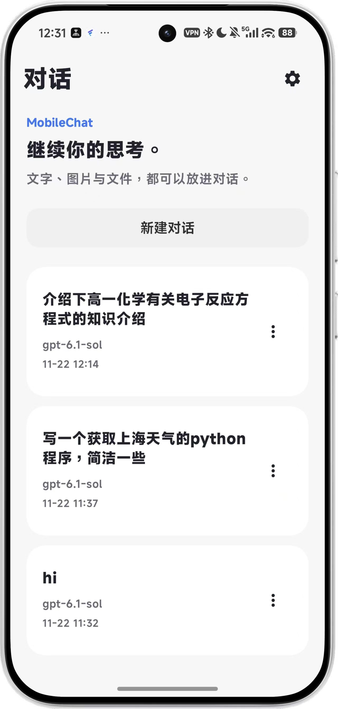
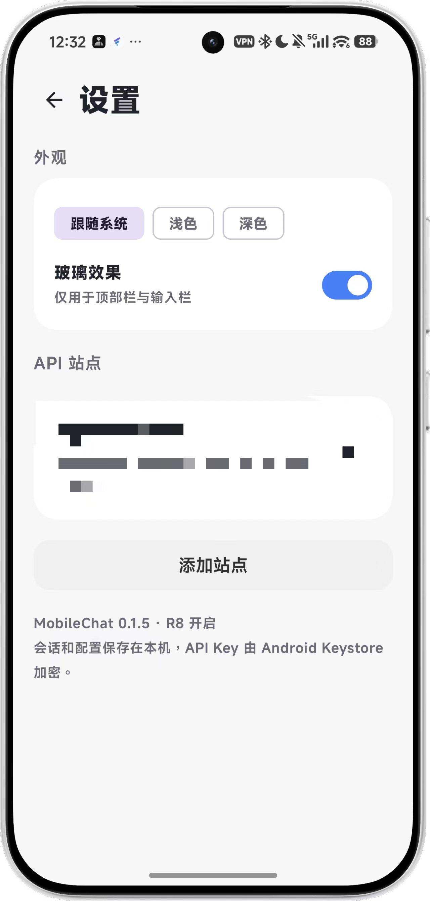
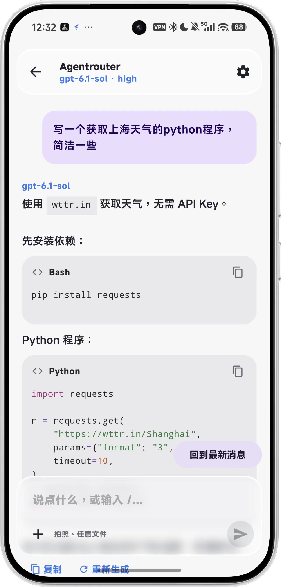

<div align="center">

# MobileChat

**原生、简洁、可自定义站点的 Android AI 对话客户端**


[下载](#下载与安装) · [使用](#开始使用) · [构建](#构建) · [反馈](https://github.com/MikaPai-team/MobileChat/issues) · [MikaPai-team](https://github.com/MikaPai-team)

</div>

基于 Kotlin、Jetpack Compose 与 Miuix 打造。把文字、图片与文件放进对话，自由配置支持 Responses API 的站点和模型，在手机上继续你的思考。

## 主要功能

| 功能 | 说明 |
| --- | --- |
| 多站点与模型 | 自定义完整接口地址、API Key、模型列表和默认模型；会话内切换站点与模型 |
| 流式对话 | 逐步显示回复，支持停止生成、重新生成、复制回答与本地会话历史 |
| 图片与文件 | 从输入栏选择图片、调用系统相机拍照，或导入任意格式的文件 |
| Markdown | 标题、列表、引用、链接与表格；代码卡片带语言标识、语法高亮和复制按钮 |
| 数学与化学公式 | 原生 LaTeX 渲染，支持行内与独立公式、上下标、电荷与箭头 |
| 推理设置 | 按站点或会话选择推理强度；展示服务实际返回的思考摘要与进展 |
| 会话命令 | `/model` 切换模型，`/effort` 设置推理强度，`/help` 查看帮助 |
| 外观与动效 | 跟随系统、浅色与深色主题；可选顶部栏和输入栏玻璃效果、回答渐显与页面转场 |
| 本地保存 | Room / DataStore 保存会话与设置，API Key 通过 Android Keystore 加密 |
| 兼容选项 | 按站点启用 Codex HTTP 请求兼容模式，并提供连接测试 |

模型名称、图片与文件解析、推理强度及思考摘要是否可用，取决于所选站点和模型。应用直接请求配置的完整 Responses 接口地址。

## 界面预览

<div align="center">

**继续你的思考。文字、图片与文件，都可以放进对话。**





</div>

以上为提供的三张应用截图，设置页展示的是 0.1.5。当前发布版本为 0.1.6，界面会随版本、主题和设备尺寸有所不同。

玻璃效果默认关闭，开启后仅用于聊天顶部栏与输入栏；Android 13+ 且硬件加速时使用背景模糊，其他设备使用实色背景。

## 下载与安装

从 [GitHub Releases](https://github.com/MikaPai-team/MobileChat/releases/latest) 获取最新安装包与发布说明。

- 系统要求：Android 8.0+（API 26）。
- 安装 APK 时需允许对应来源安装应用。
- 当前版本：**0.1.6**，versionCode **7**，包名 `com.mobilechat.app`。

每次默认提供两种非调试构建：

| 安装包 | R8 与资源缩减 | 用途 |
| --- | --- | --- |
| [MobileChat-0.1.6-r8-on.apk](https://github.com/MikaPai-team/MobileChat/releases/download/v0.1.6/MobileChat-0.1.6-r8-on.apk) | 开启代码优化、缩减 / 混淆与资源缩减 | 日常使用，安装包更小 |
| [MobileChat-0.1.6-r8-off.apk](https://github.com/MikaPai-team/MobileChat/releases/download/v0.1.6/MobileChat-0.1.6-r8-off.apk) | 关闭代码与资源缩减 | 对比运行表现与排查优化兼容问题 |

两版共用包名、版本和现有签名证书，可覆盖安装及互换，不需要卸载清除聊天数据。当前沿用已有 Android Debug 证书以保持升级兼容，**两个 APK 本身均为非调试构建**。Release 同时附带各 APK 的 SHA-256 校验文件。

## 开始使用

1. 打开「设置 → 添加站点」，填写站点名称、完整 Responses 接口地址和 API Key。
2. 地址示例：`https://example.com/v1/responses`。应用不会自动追加 `/v1` 或 `/responses`；Key 留空时不发送 Authorization。
3. 模型名称每行一个，并选择默认模型。初始列表中的名称是可编辑示例，实际可用模型以站点支持为准。
4. 按需填写系统提示词、最大输出 token 数与推理强度。未设置的可选字段不发送；思考进展默认开启，站点不支持时可关闭。
5. 点击「测试连接」，保存后新建对话。通过输入栏加号选择图片、拍照或导入文件，再发送消息。
6. 会话顶部可切换站点和模型，生成期间禁止切换。使用「停止」中断回复，或对最后一条助手回复重新生成。

| 命令 | 作用 |
| --- | --- |
| `/model` / `/model 模型名称` | 打开模型选择，或直接切换当前会话模型 |
| `/effort` / `/effort high` | 打开推理强度选择，或直接设置 |
| `/effort default` | 恢复跟随站点默认推理强度 |
| `/help` | 查看命令帮助 |

推理强度支持 `none`、`minimal`、`low`、`medium`、`high`、`xhigh`。命令不会进入聊天历史或发送到服务端，并保留待发送附件。

若站点提示 `unauthorized client detected`，可在该站点「连接信息」中开启「Codex 兼容」。该模式参照公开 Codex CLI 的 HTTP 请求形态，使用填写的接口地址与 Bearer Key；兼容模式不发送最大输出 token 上限，站点是否允许该客户端仍由服务端决定。

图片使用图片输入；小型可解码 TXT / Markdown 使用文本输入，其他文件通过内联 `input_file` 发送，无需额外 Files API。单个附件及完整请求中含历史的附件原始总大小须小于 50 MB，文件能否解析取决于站点及模型。

## 最近更新

- **0.1.6**：接入原生 LaTeX 公式渲染，兼容四种常见公式分隔符；修复中文标点附近加粗标记外露，保护代码、转义与价格文本。
- **0.1.5**：修复深色主题下文字与图标颜色；新增带语言标题、复制按钮和语法高亮的代码卡片。
- **0.1.4**：修复玻璃模糊越界，调整浅深主题覆色，并让聊天内容避开状态栏。
- **0.1.3**：新增模型与推理强度命令、思考进展、回答渐显、系统相机拍照与任意文件导入。

实现记录与各版本验证范围见 [IMPLEMENTATION_STATUS.md](IMPLEMENTATION_STATUS.md)。当前 APK 已完成编译及产物核对；公式显示、真实站点兼容性和真机性能仍需设备验证。

## 构建

需要 JDK 21 与 Android SDK Platform 37；项目使用 Gradle 9.5.0、AGP 9.3.2、Kotlin Compose / Serialization 插件 2.4.0 与 Miuix 0.9.4。配置本机 `local.properties` 中的 `sdk.dir`，或设置 Android SDK 环境变量。

```powershell
git clone https://github.com/MikaPai-team/MobileChat.git
cd MobileChat
.\scripts\package.ps1 -Variant both
```

脚本默认同时生成 R8 开启 / 关闭两版 APK，复制到 `dist/`，核对签名、非调试标记及 SHA-256，并生成 `.sha256` 与 `package-report.json`。

- 依赖已缓存时可加 `-Offline`。
- 下载依赖需要本机代理时可加 `-Proxy http://127.0.0.1:7890`。
- 明确只需一版时使用 `-Variant r8` 或 `-Variant noR8`。
- 后续可安装升级应递增 versionCode；同次发布两版的 versionCode 必须一致。

本仓库不包含私有签名密钥。直接构建会使用构建机器的 Android Debug 证书；若需覆盖安装已发布 APK，必须由发布者使用相同的现有证书签名。

源码检查、测试命令、协议细节和完整打包说明见 [开发与验证指南](docs/DEVELOPMENT.md)。

## 参与贡献

欢迎通过 [Issue](https://github.com/MikaPai-team/MobileChat/issues) 反馈问题或提出建议，也欢迎提交 [Pull Request](https://github.com/MikaPai-team/MobileChat/pulls)。反馈时请附上应用版本、R8 状态、Android 版本和复现步骤，并隐藏 API Key 等私密信息。

## 致谢

- [Kotlin](https://kotlinlang.org/) / [Kotlin Coroutines](https://github.com/Kotlin/kotlinx.coroutines) — 开发语言与异步处理
- [Jetpack Compose](https://developer.android.com/jetpack/compose) — 声明式 UI 框架
- [Miuix](https://github.com/compose-miuix-ui/miuix) — 界面组件与背景模糊
- [Room](https://developer.android.com/training/data-storage/room) / [DataStore](https://developer.android.com/topic/libraries/architecture/datastore) — 本地数据与偏好存储
- [OkHttp](https://github.com/square/okhttp) — 网络请求与流式响应
- [Coil](https://github.com/coil-kt/coil) — 图片加载
- [Markwon](https://github.com/noties/Markwon) / [Prism4j](https://github.com/noties/Prism4j) / [JLatexMath](https://github.com/opencollab/jlatexmath) — Markdown、语法高亮与公式渲染
- [OpenAI Codex](https://github.com/openai/codex) — 可选 HTTP 兼容模式的公开协议参考
- [BiliPai](https://github.com/jay3-yy/BiliPai) — README 结构与展示方式参考

## 隐私与数据

会话、附件和配置保存在本机，API Key 使用 Android Keystore AES-GCM 加密，系统备份关闭。每次发送会把当前会话的历史和附件提交给所选 API 站点；切换站点后，历史也会发送至新站点。`store: false` 是请求选项，服务端数据处理仍取决于站点自身的规则。

HTTP 接口会以明文连接，建议优先使用 HTTPS。手机上的 `127.0.0.1` 指手机本身；连接电脑中转站时，应填写手机可访问的电脑局域网地址。

<div align="center">

<sub>MobileChat 0.1.6（7） · 更新于 2026-11-22 · [MikaPai-team](https://github.com/MikaPai-team)</sub>

</div>
